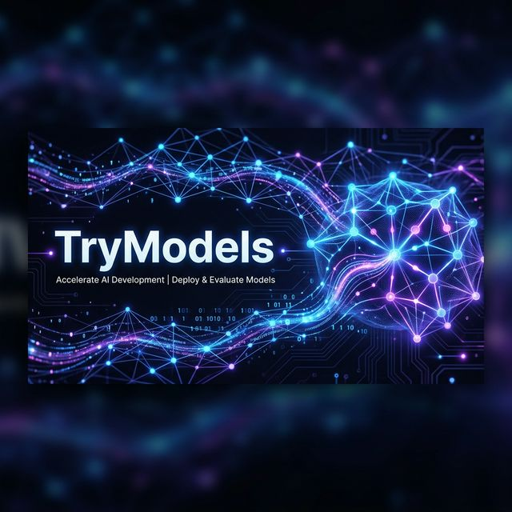
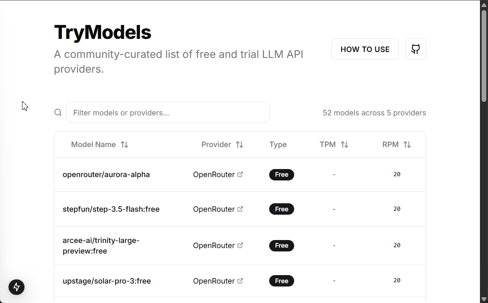

<p align="center">
  
</p>

#  TryModels

[](https://nextjs.org/)
[](https://www.typescriptlang.org/)
[](https://tailwindcss.com/)
[](https://opensource.org/licenses/MIT)
[](https://trymodels.com)

> **TryModels** is a high-performance, community-first directory and API designed to bridge the gap between developers and free AI resources. It showcases modern web architecture, automated data tracking, and developer-centric UX.

---

### ✨ Why TryModels?

In the fast-moving AI landscape, finding stable free-tier models is a challenge. **TryModels** automates the discovery of Large Language Models (LLMs) that offer zero-cost access or generous free trials, providing a clean interface and a robust API for your next project.

- 🔍 **Real-time Discovery**: Always-up-to-date tracking of Gemini, OpenAI, Claude, and more.
- ⚡ **Developer API First**: Built with integration in mind. One endpoint, all models.
- 🛠 **Modern Engineering**: Architected with Next.js 15, Turbopack, and Tailwind CSS for maximum speed.
- 💎 **Vivid UX**: A premium experience for browsing model capabilities, context limits, and quotas.

<p align="center">
  
</p>

---

### 📡 Power Your App with Our API

Looking for a reliable list of free AI models for your application? Skip the manual research and plug directly into our CORS-enabled JSON endpoint.

**Endpoint:** `GET https://trymodels.com/api/models`

```ts
// Fetch the latest free models in one call
const response = await fetch("https://trymodels.com/api/models");
const { models } = await response.json();

// Example: Filter reasoning models
const reasoningModels = models.filter(m => m.reasoning);
console.log(`Found ${reasoningModels.length} reasoning-capable models!`);
```

---

### 🤝 Join the Development

This project is built for the global developer community. Whether you want to add a new provider or improve the crawler logic, your contribution is what makes this project thrive.

1. **Suggest a Model**: Found a new free tier? [Open an issue](https://github.com/aralde/trymodels/issues).
2. **Build the Core**: Fork, branch, and PR. Let's make the best AI directory together.
3. **Star the Repo**: If this tool helped you, show some love! ⭐

---

### 💻 Local Setup (For Developers)

1. **Clone**: `git clone https://github.com/aralde/trymodels.git`
2. **Install**: `npm install`
3. **Env**: `cp .env.example .env`
4. **Dev**: `npm run dev`

---

## 📄 License

This project is licensed under the [MIT License](LICENSE).

Built with ❤️ by the community
